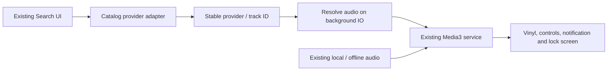

# Native audio-only streaming assessment — 29 October 2026

Historical research: the user subsequently approved the private on-device yt-dlp experiment. See [current implementation and validation](ONLINE_AUDIO.md). The visible-video proposal remains rejected.

Research only. The visible-video proposal is rejected. No YouTube API key is requested, no runtime/dependency was installed, and no Android playback, UI, database, APK or macOS application was changed in this investigation. Implementation requires a separate approval.

**Conclusion:** Android can technically reproduce the macOS interaction model with a search/resolution adapter feeding the existing Media3 service. This does not establish that an unofficial YouTube extractor is authorized, reliable for every video, or ready to ship. There is no reviewed public YouTube API that grants this exact custom audio-only/background experience.

## What the macOS source actually does

Inspected read-only:

- `Services/YouTubeSearchService.swift`: yt-dlp returns ten flat search results; stable video IDs and title/channel metadata are decoded into Songs.
- `Services/AudioStreamResolver.swift`: a separate resolver obtains an audio URL immediately before playback, preferring audio-only HLS. Its own comments acknowledge fresh direct URLs can return HTTP 403. It does not obtain a native-player entitlement from YouTube.
- `Services/PlaybackEngine.swift` and `MPVConnection.swift`: mpv plays the resolved URL with video disabled and emits state/clock/buffering events to the native UI.
- `ViewModels/MusicLibrary.swift`: serializes cancellation and track transitions, resolves before loading, then applies the resulting player events.
- `Scripts/Packaging/dependencies.json`: macOS-specific bundled binaries and pinned dependencies. Those Mach-O executables cannot run in an Android APK, even on another ARM64 CPU.

The transferable design is **search → stable track reference → resolve playable audio → native player**. SwiftUI, the desktop executable and mpv IPC do not need to be ported.

## Options

| Approach | Exact native/vinyl/background UX? | Compatibility and maintenance | Provider/approval limitation |
|---|---|---|---|
| On-device yt-dlp adapter + existing Media3 | Technically yes, when extraction returns supported audio | Closest desktop behavior; adds Python, a compatible JS/EJS stack, packaging, startup/memory and update ownership | Unofficial YouTube access; provider permission is not supplied by the tool. Not verified in Mango Music Android. |
| JVM extractor such as NewPipeExtractor + Media3 | Technically yes | Avoids Python packaging; still depends on changing site behavior; Android compatibility and GPL obligations require review | Same YouTube authorization issue; not an official playback entitlement. |
| Backend yt-dlp resolver + Media3 | Technically possible | Centralized updates, but hosting/operations/privacy/bandwidth costs; returning a server-resolved URL to a phone can fail due to IP/session/header binding | Moving extraction to a server does not change provider terms. No server or paid service is proposed for automatic creation. |
| Licensed native-audio catalog or self-hosted rights-cleared audio | Yes, if its terms grant these capabilities | Better defined API contract; native Media3 rendering retained; provider integration and catalog availability still need testing | Different catalog from YouTube; credentials, licensing and any costs need approval. |
| Official YouTube public APIs | Does not satisfy the requested full UX | Supported public player is a visible-video experience | Excluded by your decision; no key or video-player implementation is being pursued. |

### On-device yt-dlp: feasible, but not a drop-in binary

The upstream project documents Android use through [Termux](https://github.com/yt-dlp/yt-dlp/wiki/Installation#android), establishing platform feasibility, not an integrated Mango Music build. A companion terminal/runtime would add user setup, so it is not my production UX recommendation.

For a self-contained APK, use an audited Android runtime/wrapper. Older [youtubedl-android documentation](https://github.com/yausername/youtubedl-android) still describes Python 3.8, while [current yt-dlp](https://github.com/yt-dlp/yt-dlp#dependencies) requires Python 3.11+. A familiar dependency coordinate alone is insufficient evidence of current compatibility. A newer [embedded-Python wrapper](https://github.com/ffmpegkit-maintained/yt-dlp-android/blob/main/README.md) describes Python 3.13 and substantial bundled-runtime size, but I have not validated that package, its complete YouTube runtime support, or its optional paid variants, and have not selected it.

[yt-dlp's EJS documentation](https://github.com/yt-dlp/yt-dlp/wiki/EJS) also requires a compatible JavaScript runtime and matching challenge-script package for full YouTube support. These versions must be maintained together. A wrapper containing Python and yt-dlp does not by itself prove complete current YouTube support.

Android's [executable-code rules](https://developer.android.com/about/versions/10/behavior-changes-10#execute-permission) also mean a desktop-style copy-to-writable-storage-and-execute scheme is not suitable for this target-36 app. Native components must be packaged appropriately for Android ABIs. A distribution/update plan must account for [Google Play's code-update and service-access policies](https://support.google.com/googleplay/android-developer/answer/9888379); sideloading changes distribution, not the underlying provider permission.

### JVM extractor and backend tradeoffs

[NewPipeExtractor](https://github.com/TeamNewPipe/NewPipeExtractor) exposes a JVM library and supports independent use. Its current documentation calls for additional desugaring below API 33, relevant to Mango Music's min SDK 26, and uses GPL-3.0-or-later licensing. It would need distribution/licensing review, particularly if Mango Music must remain closed source. It avoids the Python layer, not extractor breakages or provider restrictions.

A backend would make releases easier to coordinate, but it is not inherently more reliable: [yt-dlp's own FAQ](https://github.com/yt-dlp/yt-dlp/wiki/FAQ#i-extracted-a-video-url-but-it-does-not-play-on-another-machine--in-my-web-browser) notes playback may depend on the same IP, cookies and HTTP headers. A server URL handed to the device can therefore be unusable. A media relay adds cost and privacy exposure; it does not resolve authorization. No backend has been created.

## Reliability expectations

These are engineering assessments, not measured Mango Music Android extractor results:

- Search success does not prove audio resolution, playback or seeking success. The full chain must be tested independently.
- Upstream changes, missing JS support, network identity changes, authentication requirements and rate limits can interrupt service. The upstream [YouTube extractor notes](https://github.com/yt-dlp/yt-dlp/wiki/Extractors#youtube) document changing access requirements and request-limit failures.
- Resolved URLs should be treated as transient credentials, not permanent track IDs. Resolve near playback, preserve the provider's required headers, support cancellation/timeouts, and use bounded error recovery rather than unbounded retries.
- Frequent compatibility monitoring and potentially urgent releases are part of operating an extractor integration. There is no basis for promising all tracks, all regions, or uninterrupted availability.
- A packaged Python/JS stack increases maintenance and attack surface. Build/update provenance and dependency licenses require evaluation. No cookies, private accounts, alternate-client tricks, anti-bot workarounds or DRM bypass are part of this proposal.

## Provider terms distinction

For official integrations, [YouTube's Developer Policies](https://developers.google.com/youtube/terms/developer-policies) restrict audio/video separation and hidden/background playback. An extractor that avoids the public Data API is still subject to the separate [YouTube Terms of Service](https://www.youtube.com/static?template=terms), including restrictions on automated access and use outside the service's authorizations or applicable written permissions.

Therefore I cannot label generic yt-dlp/NewPipe-based YouTube playback as a supported, authorized integration merely because it works on macOS, does not save a file, uses open-source code, or is sideloaded. Content ownership and permission to automate access to the hosting service are separate considerations. This is an implementation/terms assessment, not a determination that every conceivable use is unlawful.

A provider whose contract explicitly permits native audio and background playback is the stronger production foundation. [Audius](https://docs.audius.co/developers/introduction/overview/) and [Jamendo](https://developer.jamendo.com/v3.0/tracks) document search/stream APIs and are candidates to evaluate, not selected replacements or assurances of rights to every track, free access, offline use or catalog parity. Your approval would be required before changing provider or adding credentials/costs.

## Recommended architecture

Keep the existing Kotlin/Compose UI, vinyl, Room library, queue, MediaSessionService, audio focus and system controls. Add a small provider layer around the current playback system after approval:

- Separate catalog metadata from playback resolution. Result fields should distinguish a verified artist from a channel/uploader.
- Resolve each queued provider item just before use, including automatic background transitions; do not make resolution depend solely on the foreground Search screen.
- Return URI, MIME/container type, required HTTP headers and any known validity constraints. Keep this transient result out of persisted track identity.
- Keep one service-owned ExoPlayer. Add the matching Media3 HLS module if HLS is selected: the current app has ExoPlayer/session 1.8.0 but no HLS module, and the macOS resolver prefers HLS. [Media3 HLS documentation](https://developer.android.com/media/media3/exoplayer/hls) confirms this module requirement. mpv is unnecessary; FFmpeg is not a prerequisite for ordinary directly supported audio playback.
- Limit prefetch to the next item, cancel obsolete searches/resolutions, preserve request identity, and surface unavailable/auth-required/network/timeout errors. Keep downloads capability-gated; streaming access does not imply offline rights.
- Preserve existing Room rows. Any future additional provider metadata must use a non-destructive migration if needed, independently of the existing local library.

**Recommendation:** approve the provider-adapter architecture in principle, with a provider that explicitly permits the requested native audio experience for production. On-device resolution is the closest technical match to the desktop and avoids an initial backend. If YouTube specifically is mandatory, the unofficial-extractor path remains an authorization and reliability decision; I would scope any separately approved feasibility work to authorized access and keep it isolated from the working app. I do not recommend shipping a generic YouTube extractor as an officially supported/compliant production integration.

Before implementation, approve the source/catalog path and, for any extractor option, its authorization/distribution assumptions and maintenance burden. No visible video player, YouTube API key request or streaming implementation is pending automatic execution.

## What was and was not tested

This investigation inspected source and current primary documentation. It did not install yt-dlp on Android, execute extraction, modify app dependencies or playback, run a streaming proof of concept, change the existing APK, or rerun tests unrelated to a code change. Previous local playback/alignment tests remain prior evidence only; they are not evidence of YouTube playback. APK and protected playback/data/launcher hashes still match their recorded baseline. Implementation awaits approval.
